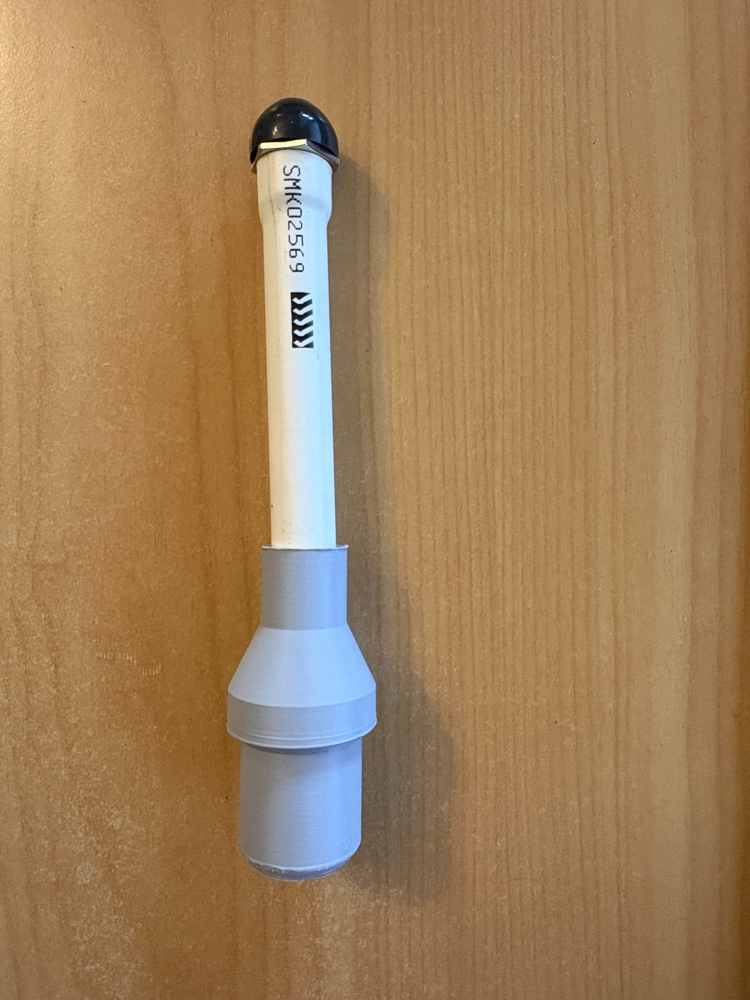

# UWH wireless siren enclosure

Working units were constructed using **grey PLA filament**.

| File | Part |
|---|---|
| [UWH_Siren_Screw_Cup.step](UWH_Siren_Screw_Cup.step) | Removable closed cup, with 5 mm outside and 2 mm inside bottom radii |
| [UWH_Siren_Pipe_Adaptor.step](UWH_Siren_Pipe_Adaptor.step) | Pipe adaptor with mating thread and internal pipe stop; no screw hole |

## Intended assembly

The pipe receiver has a **21.4 mm internal diameter** for the specified **Marley DN15 pipe with 21.34 mm outside diameter**. This provides 0.06 mm nominal diametral clearance; check the actual printed fit before assembly. The pipe insertion section is 25 mm long, the transition to the threaded collar is **10 mm long**, and the adaptor is 44 mm long overall. The mating thread and sealing groove are retained from the supplied design.

The removable cup houses the bare Aqara board, measured at 38 × 31 × 5 mm, with its 38 mm dimension along the cup. Battery and external-button wires pass through the adaptor's internal stop into the pipe. Two AA batteries sit in the pipe shaft; the external Jaycar button is wired to the board's existing switch contacts.

Affix the pipe adaptor to the pipe with a material such as **RTV silicone**, selected for compatibility with the pipe and printed part, to provide water resistance while allowing relatively easy removal for AA battery replacement. Allow it to cure before use and check the seal again after battery replacement.

**Do not use screws to secure the adaptor to the pipe: they risk penetrating an AA battery or shorting the wires.** The revised adaptor has no screw hole.

The STEP geometry is the authority for manufacturing dimensions. Import the files at their original scale. They contain solid geometry rather than a native Fusion feature history. The cup geometry is unchanged; its rounded bottom is already present in the GitHub file. For assembly in CAD, move the cup 10 mm towards the pipe socket to match the shortened adaptor.

## Early working unit

This photograph shows an early working version, before the shortened transition and revised pipe socket described above.

## Printing and fit checks

- Test the socket on the actual pipe and check the mating threads with the intended printer settings. The small nominal clearance may require print compensation or finishing.
- Retain the joint's O-ring seal arrangement and check its sealing faces, the pipe joint and external button.
- Test water resistance without electronics installed. These prints have not been qualified for submersion.
- Obtain estimated part weights from the printer's slicer using the actual wall and infill settings.

Both STEP files import as one valid solid each. The revised adaptor's bore, transition length and unchanged mating thread were checked in CAD; the revision still requires a physical fit and sealing test.
