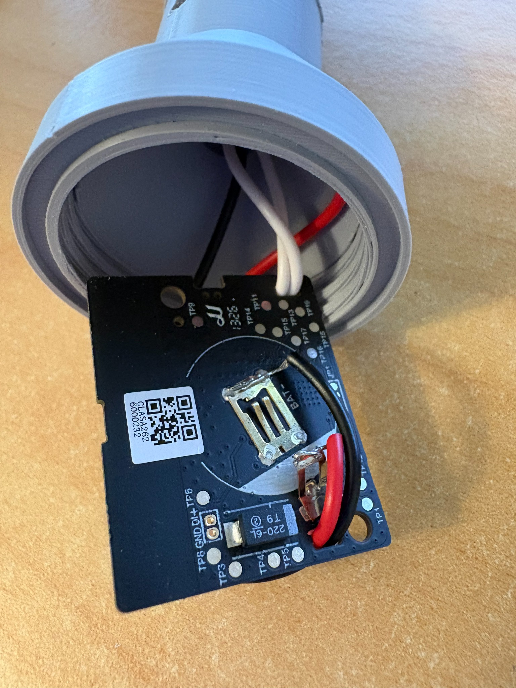
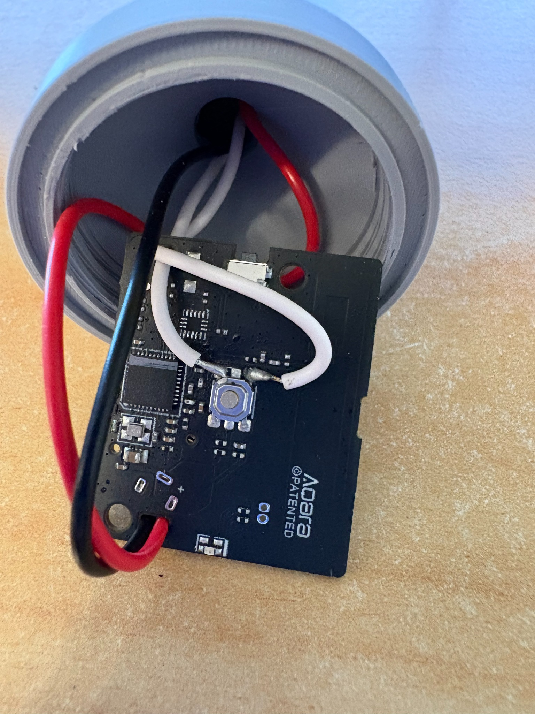
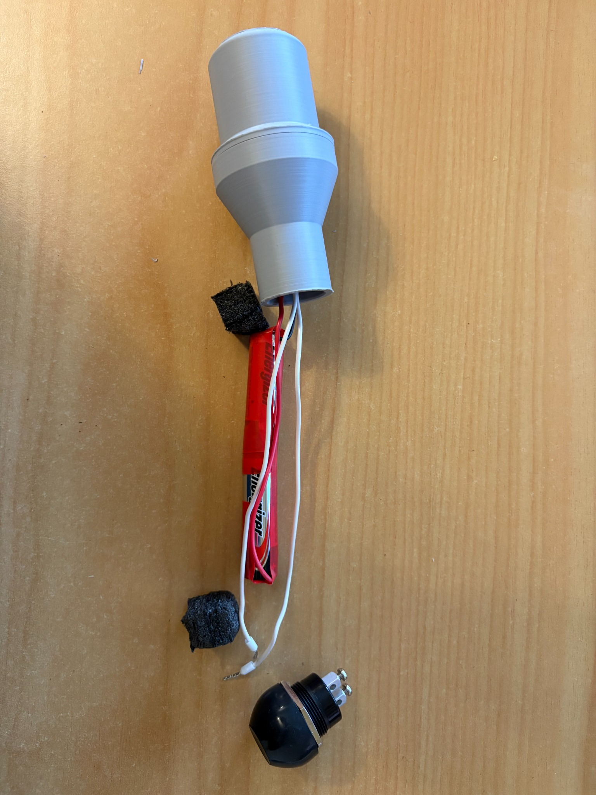

# UWH wireless siren enclosure

Working units were constructed using **grey PLA filament**.

| File | Part |
|---|---|
| [UWH_Siren_Screw_Cup.step](UWH_Siren_Screw_Cup.step) | Removable closed cup, with 5 mm outside and 2 mm inside bottom radii |
| [UWH_Siren_Pipe_Adaptor.step](UWH_Siren_Pipe_Adaptor.step) | Pipe adaptor with mating thread and internal pipe stop |

## Intended assembly

The supplied STEP is the exact version uploaded as **UWH_Siren_Pipe_Adaptor(1).step**, which has been physically tested and confirmed to fit the DN15 pressure pipe perfectly. Uploads labelled (2) and (3) contain the same file. It is stored here under the stable filename **UWH_Siren_Pipe_Adaptor.step**.

The CAD pipe receiver has a **22.4 mm internal diameter**, a **25 mm insertion section**, a **20 mm transition** to the threaded collar, and **54 mm overall length**. These dimensions describe the fit-tested file and replace the previous 21.4 mm bore / 10 mm transition revision. Printed fit depends on the printer and actual pipe; retain the tested geometry when reproducing this unit.

The removable cup houses the bare Aqara board, measured at 38 × 31 × 5 mm, with its 38 mm dimension along the cup. Battery and external-button wires pass through the adaptor's internal stop into the pipe. Two AA batteries sit in the pipe shaft; the external waterproof normally-open button is wired to the Aqara board's existing switch contacts.

Affix the pipe adaptor to the pipe with a material such as **RTV silicone**, to provide some water resistance while allowing relatively easy removal for AA battery replacement (which should last years). Allow it to cure before use and check the seal again after battery replacement.

**Do not use screws to secure the adaptor to the pipe: they risk penetrating an AA battery or shorting the wires.** The fit-tested STEP retains the original radial screw hole; leave it unused and seal it for water resistance.

The STEP geometry is the authority for manufacturing dimensions. Import the files at their original scale. They contain solid geometry.
## Aqara board wiring and strain relief

The photographs below show an example of wiring added to the Aqara Zigbee button circuit board.

| Wire colour | Connection |
|---|---|
| Two white wires | Across the existing switch contacts, leading to the external waterproof button |
| Red | Positive (+) end of the two-AA battery supply in the pipe |
| Black | Negative (−) end of the two-AA battery supply in the pipe |

The two AA cells are connected in series. Route the insulated wires through the **existing holes in the Aqara circuit board** for strain relief, as shown, leaving a little slack between each hole and its solder joint so movement does not pull directly on the joint.

Pack **foam or bubble wrap at both ends inside the pipe** to stop the AA batteries sliding up and down or rattling. The wireless siren is not a child's rattle! The foam also keeps the cells secure without pulling on the wires. Leave the packing removable for battery replacement.

### Expanded assembly view

Expanded view showing the battery wiring and suitably sized foam pieces for both ends of the pipe. When assembled, the foam keeps the two AA cells pressed together so they do not separate during use, and keeps the battery wires in contact with the terminals.

## Early working unit

This photograph shows an early working unit.

## Printing and fit checks

- Test the socket on the actual pipe and check the mating threads with the intended printer settings. Check a sample print before making a batch.
- Retain the joint's O-ring seal arrangement and check its sealing faces, the pipe joint and external button.
- Test water resistance without electronics installed. These prints have not been qualified for submersion but should rate at least IPX4.

Both STEP files import as one valid solid each.
